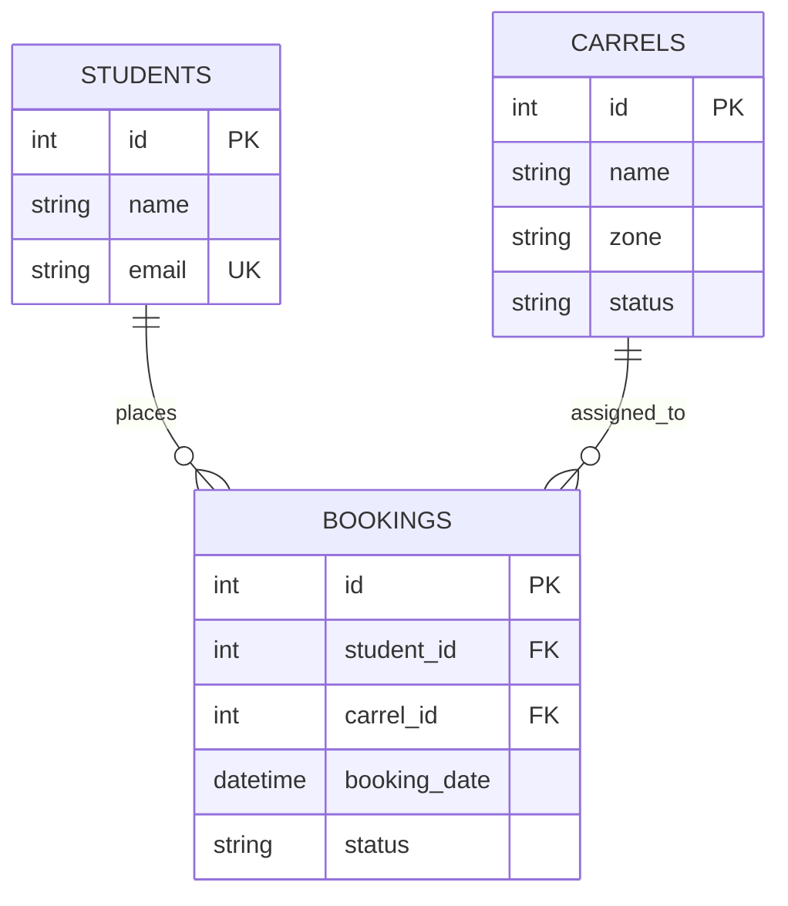

# ☕ StudySpot Cafe – Study Carrel Booking System

A robust, production-grade RESTful API backend built with **Node.js**, **Express.js**, and **SQLite** for managing study carrel reservations in a cafe/library environment.

Developed as a college Backend Development Fundamentals group assignment, this project demonstrates clean architecture, modular routing, database constraints, SQL JOIN queries, atomic transaction handling, input validation, automated testing with Jest/Supertest, and complete Postman documentation.

---

## 📖 Table of Contents

1. [Project Introduction](#1-project-introduction)
2. [Problem Statement](#2-problem-statement)
3. [Project Objectives](#3-project-objectives)
4. [Technology Stack](#4-technology-stack)
5. [Database Design](#5-database-design)
6. [Database Relationships](#6-database-relationships)
7. [Project Folder Structure](#7-project-folder-structure)
8. [Installation Instructions](#8-installation-instructions)
9. [How to Start the Server](#9-how-to-start-the-server)
10. [API Endpoint Documentation](#10-api-endpoint-documentation)
11. [Sample Request & Response Examples](#11-sample-request--response-examples)
12. [Validation & Error Handling](#12-validation--error-handling)
13. [The Twist Rule: No Double Booking](#13-the-twist-rule-no-double-booking)
14. [Automated Testing & Test Evidence](#14-automated-testing--test-evidence)
15. [No Double Booking – Twist Test Results](#no-double-booking--twist-test-results)
16. [Postman Collection Usage](#16-postman-collection-usage)
17. [College Presentation Guide](#17-college-presentation-guide)

---

## 1. Project Introduction

**StudySpot Cafe** provides quiet, distraction-free study spaces (carrels) arranged in different zones (Zone A, Zone B, Zone C) for university students. This backend application provides the complete reservation logic, tracking which student is occupying which carrel, preventing scheduling disputes, and logging full booking histories.

---

## 2. Problem Statement

Previously at StudySpot Cafe, students argued over available carrels because there was no centralized or digital system to check which carrels were already booked. Students frequently sat in carrels that had already been claimed, leading to disruptions, double bookings, and frustration.

---

## 3. Project Objectives

- Provide a reliable REST API to view, add, update, and remove students and carrels.
- Filter study carrels dynamically by zone (e.g., Zone A, Zone B) using URL query parameters.
- Enable students to reserve available carrels with automatic status updates (`Available` ➔ `Booked`).
- Provide an integrated SQL JOIN endpoint (`/api/bookings/details`) to display human-readable student names and carrel names instead of raw foreign keys.
- **Enforce the Twist Rule**: Guarantee that two active students can **never** book the same carrel simultaneously by using atomic database transactions.
- Facilitate carrel returns, returning carrels back to `Available` status so other students can immediately book them.

---

## 4. Technology Stack

| Component | Technology | Description |
| :--- | :--- | :--- |
| **Runtime** | Node.js (v18+) | Server-side JavaScript runtime |
| **Framework** | Express.js (v4.21+) | Fast, unopinionated web framework |
| **Database** | SQLite3 / node:sqlite | Lightweight, embedded SQL relational database |
| **Testing** | Jest & Supertest | Automated test runner and HTTP assertion library |
| **Dev Tools** | Nodemon & Dotenv | Hot-reloading and environment variable management |
| **API Client** | Postman v2.1 | Pre-configured collection for manual and team testing |

---

## 5. Database Design

The database schema consists of exactly **three related tables** with foreign key constraints enabled (`PRAGMA foreign_keys = ON;`).



### Table 1: `students`
| Column | Type | Constraints | Description |
| :--- | :--- | :--- | :--- |
| `id` | INTEGER | PRIMARY KEY AUTOINCREMENT | Unique student identifier |
| `name` | TEXT | NOT NULL | Student full name |
| `email` | TEXT | NOT NULL, UNIQUE | Student contact email |

### Table 2: `carrels`
| Column | Type | Constraints | Description |
| :--- | :--- | :--- | :--- |
| `id` | INTEGER | PRIMARY KEY AUTOINCREMENT | Unique carrel identifier |
| `name` | TEXT | NOT NULL | Carrel name (e.g. "Carrel 4") |
| `zone` | TEXT | NOT NULL | Zone code (e.g. "A", "B", "C") |
| `status` | TEXT | NOT NULL, CHECK(`Available`, `Booked`) | Current occupancy state |

### Table 3: `bookings`
| Column | Type | Constraints | Description |
| :--- | :--- | :--- | :--- |
| `id` | INTEGER | PRIMARY KEY AUTOINCREMENT | Unique booking identifier |
| `student_id` | INTEGER | NOT NULL, FOREIGN KEY ➔ `students(id)` | Reserved by student |
| `carrel_id` | INTEGER | NOT NULL, FOREIGN KEY ➔ `carrels(id)` | Reserved study carrel |
| `booking_date`| DATETIME| NOT NULL DEFAULT CURRENT_TIMESTAMP | Timestamp of reservation |
| `status` | TEXT | NOT NULL, CHECK(`Active`, `Returned`) | Lifecycle state of booking |

---

## 6. Database Relationships

1. **One-to-Many (`students` ➔ `bookings`)**:
   - A single student can hold multiple bookings across their history.
   - Each booking record is linked to exactly one student via `bookings.student_id`.
2. **One-to-Many (`carrels` ➔ `bookings`)**:
   - A study carrel can have multiple historical booking records over time.
   - However, **at any single point in time, at most ONE booking may have status `Active` for a given carrel**.
3. **Foreign Key Enforcement**:
   - Enabled using `PRAGMA foreign_keys = ON;`.
   - Creating a booking with a non-existent `student_id` or `carrel_id` triggers validation and foreign key constraints.

---

## 7. Project Folder Structure

```
StudySpot-Cafe/
│
├── config/
│   └── database.js               # SQLite connection, schema initialization, seed data
│
├── controllers/
│   ├── studentController.js      # Student CRUD handler methods
│   ├── carrelController.js       # Carrel CRUD and zone search handler methods
│   └── bookingController.js      # Booking CRUD, 3-table JOIN, Return, & Twist Rule
│
├── routes/
│   ├── studentRoutes.js          # /api/students routing
│   ├── carrelRoutes.js           # /api/carrels routing
│   └── bookingRoutes.js          # /api/bookings routing
│
├── middleware/
│   ├── validation.js             # Input validation for requests
│   └── errorHandler.js           # Centralized HTTP error handler
│
├── tests/
│   └── booking.test.js           # Automated Jest/Supertest suite (14 tests)
│
├── database/
│   ├── studyspot.db              # SQLite development database file
│   └── studyspot_test.db         # SQLite isolated automated test database
│
├── postman/
│   └── StudySpot-API.postman_collection.json # Exported Postman test suite
│
├── app.js                        # Express app setup and route registration
├── server.js                     # HTTP server bootstrapper
├── package.json                  # Dependencies and npm scripts
├── .env.example                  # Environment variable blueprint
├── .env                          # Local environment variables
└── README.md                     # Comprehensive project documentation
```

---

## 8. Installation Instructions

### Prerequisites
- [Node.js](https://nodejs.org/) (v18 or higher recommended)
- [npm](https://www.npmjs.com/) (bundled with Node.js)
- [Postman](https://www.postman.com/) (optional, for manual API exploration)

### Step-by-Step Setup
1. Clone or download this project folder into your local environment.
2. Open a terminal / command prompt inside the project folder:
   ```bash
   cd "group assignment"
   ```
3. Install project dependencies:
   ```bash
   npm install
   ```
4. Copy the environment variables:
   ```bash
   cp .env.example .env
   ```

---

## 9. How to Start the Server

### Production / Standard Mode
```bash
npm start
```
Starts the server using standard Node.js on port `5000`.

### Development Mode (with Hot Reloading)
```bash
npm run dev
```
Starts the server with `nodemon`, automatically restarting on code changes.

### Console Output
When the server starts successfully, you will see:
```text
====================================================
☕ StudySpot Cafe Server is running!
🔗 Localhost URL: http://localhost:5000
📚 Health check:  http://localhost:5000/api/health
📋 Bookings JOIN: http://localhost:5000/api/bookings/details
====================================================
```

---

## 10. API Endpoint Documentation

### Base URL: `http://localhost:5000`

### 🧑‍🎓 Students Endpoints (`/api/students`)
| Method | Endpoint | Description | Status Codes |
| :--- | :--- | :--- | :--- |
| `GET` | `/api/students` | Retrieve all registered students | 200, 500 |
| `GET` | `/api/students/:id` | Retrieve student by ID | 200, 404, 500 |
| `POST` | `/api/students` | Register a new student | 201, 400, 409, 500 |
| `PUT` | `/api/students/:id` | Update student name or email | 200, 400, 404, 409 |
| `DELETE` | `/api/students/:id` | Delete student (blocked if active booking) | 200, 404, 409 |

### 🪑 Study Carrels Endpoints (`/api/carrels`)
| Method | Endpoint | Description | Status Codes |
| :--- | :--- | :--- | :--- |
| `GET` | `/api/carrels` | Retrieve all study carrels | 200, 500 |
| `GET` | `/api/carrels?zone=A` | **Search/Filter carrels by zone** | 200, 500 |
| `GET` | `/api/carrels/:id` | Retrieve carrel details by ID | 200, 404, 500 |
| `POST` | `/api/carrels` | Add a new carrel to a zone | 201, 400, 500 |
| `PUT` | `/api/carrels/:id` | Update carrel name, zone, or status | 200, 400, 404 |
| `DELETE` | `/api/carrels/:id` | Delete carrel (blocked if active booking) | 200, 404, 409 |

### 📅 Bookings Endpoints (`/api/bookings`)
| Method | Endpoint | Description | Status Codes |
| :--- | :--- | :--- | :--- |
| `GET` | `/api/bookings` | Retrieve all raw booking records | 200, 500 |
| `GET` | `/api/bookings/details` | **3-Table SQL JOIN** (human-readable names) | 200, 500 |
| `GET` | `/api/bookings/:id` | Retrieve a booking record by ID | 200, 404, 500 |
| `POST` | `/api/bookings` | **Create booking (No-Double-Booking rule)** | 201, 400, 404, 409 |
| `PUT` | `/api/bookings/:id/return` | **Return a carrel (reverts to Available)** | 200, 400, 404 |
| `PUT` | `/api/bookings/:id` | Update booking status or date | 200, 400, 404, 409 |
| `DELETE` | `/api/bookings/:id` | Delete a booking record | 200, 404, 500 |

---

## 11. Sample Request & Response Examples

### 1. Create a Booking (`POST /api/bookings`)
**Request Body:**
```json
{
  "student_id": 1,
  "carrel_id": 4
}
```
**Response (HTTP 201 Created):**
```json
{
  "message": "Booking created successfully",
  "booking": {
    "id": 1,
    "student_id": 1,
    "student_name": "Asha",
    "carrel_id": 4,
    "carrel_name": "Carrel 4",
    "carrel_zone": "B",
    "booking_date": "2026-11-15T11:15:00.000Z",
    "status": "Active"
  }
}
```

### 2. Double-Booking Conflict (`POST /api/bookings`)
When Ravi attempts to book Carrel 4 while Asha's booking is Active:
**Request Body:**
```json
{
  "student_id": 2,
  "carrel_id": 4
}
```
**Response (HTTP 409 Conflict):**
```json
{
  "error": "Carrel 4 is already booked"
}
```

### 3. Return a Carrel (`PUT /api/bookings/:id/return`)
**Response (HTTP 200 OK):**
```json
{
  "message": "Carrel returned successfully",
  "booking": {
    "id": 1,
    "student_id": 1,
    "carrel_id": 4,
    "booking_date": "2026-11-15T11:15:00.000Z",
    "status": "Returned"
  }
}
```

### 4. 3-Table SQL JOIN (`GET /api/bookings/details`)
**Response (HTTP 200 OK):**
```json
[
  {
    "booking_id": 1,
    "student_id": 1,
    "student_name": "Asha",
    "student_email": "asha@studyspot.com",
    "carrel_id": 4,
    "carrel_name": "Carrel 4",
    "carrel_zone": "B",
    "booking_date": "2026-11-15T11:15:00.000Z",
    "booking_status": "Active"
  }
]
```

### 5. Search Carrels by Zone (`GET /api/carrels?zone=A`)
**Response (HTTP 200 OK):**
```json
[
  {
    "id": 1,
    "name": "Carrel 1",
    "zone": "A",
    "status": "Available"
  },
  {
    "id": 2,
    "name": "Carrel 2",
    "zone": "A",
    "status": "Available"
  }
]
```

---

## 12. Validation & Error Handling

All incoming requests pass through specialized middleware (`middleware/validation.js`):
- **Empty Fields**: Names and zones cannot be blank or whitespace-only.
- **Email Format**: Must conform to valid RFC email syntax (e.g., `user@domain.com`).
- **Entity Existence**: Student ID and Carrel ID are verified to exist in the database before booking is allowed.
- **Allowed Enumerations**: Carrel status must be `Available` or `Booked`; Booking status must be `Active` or `Returned`.
- **Standard HTTP Status Codes**:
  - `200 OK` – Resource retrieved or updated successfully.
  - `201 Created` – Resource created successfully.
  - `400 Bad Request` – Missing required field or invalid format.
  - `404 Not Found` – Requested ID does not exist.
  - `409 Conflict` – Double booking attempt or duplicate unique email.
  - `500 Internal Server Error` – Unhandled server exception.

---

## 13. The Twist Rule: No Double Booking

### The Business Requirement
A study carrel can **NEVER** be booked by two active students simultaneously. If Carrel 4 is active with Asha, and Ravi attempts to book Carrel 4, the system must immediately reject Ravi's request with **HTTP 409 Conflict** and the exact message:
```json
{
  "error": "Carrel 4 is already booked"
}
```

### Technical Implementation
1. **Atomic Transaction (`BEGIN IMMEDIATE;` ... `COMMIT;`)**:
   In `controllers/bookingController.js`, booking creation is wrapped in an atomic database transaction. This prevents concurrency race conditions where two requests arrive at the same millisecond.
2. **Pre-condition Validation**:
   The transaction checks if there is any existing row in `bookings` where `carrel_id = ? AND status = 'Active'`, or if `carrels.status = 'Booked'`.
3. **Rejection**:
   If an active booking exists, a `409 Conflict` error is thrown, rolling back any changes.
4. **State Transition**:
   - Booking Creation: Carrel status becomes `Booked`.
   - Returning (`PUT /api/bookings/:id/return`): Booking status becomes `Returned` and Carrel status becomes `Available`.
   - Re-booking: Once returned, any student (e.g. Ravi) can book that carrel immediately.

---

## 14. Automated Testing & Test Evidence

The project includes an automated test suite in [tests/booking.test.js](file:///c:/Users/hithe/OneDrive/Desktop/group%20assignment/tests/booking.test.js) executing with **Jest** and **Supertest**.

### The 3 Mandatory Test Scenarios (Section 8)
1. **TEST 1 – Successful Booking**:
   - Student Asha books Carrel 4.
   - Result: `HTTP 201 Created`, Carrel 4 status becomes `Booked`, Asha is the active student.
2. **TEST 2 – Prevent Double Booking**:
   - Student Ravi tries to book Carrel 4 while Asha's booking is still active.
   - Result: `HTTP 409 Conflict`, error message is `"Carrel 4 is already booked"`, no second active booking inserted.
3. **TEST 3 – Return and Rebook**:
   - Return Asha's booking (`PUT /api/bookings/:id/return`).
   - Carrel 4 status returns to `Available`.
   - Ravi books Carrel 4.
   - Result: `HTTP 201 Created`, Ravi becomes active student.

### How to Run Tests
```bash
npm test
```

### Verified Test Run Output
```text
PASS tests/booking.test.js
  StudySpot Cafe - Study Carrel Booking System Test Suite
    8. Mandatory Double-Booking Prevention Scenarios
      √ TEST 1 – Successful Booking: Book Carrel 4 to Asha (343 ms)
      √ TEST 2 – Prevent Double Booking: Try booking Carrel 4 to Ravi while Asha booking is active (225 ms)
      √ TEST 3 – Return and Rebook: Return Asha booking, then book Carrel 4 to Ravi (260 ms)
    5. SQL JOIN Details Endpoint
      √ GET /api/bookings/details returns complete joined data across 3 tables (163 ms)
    4. Carrels Search by Zone
      √ GET /api/carrels?zone=A returns only Zone A carrels (207 ms)
      √ GET /api/carrels returns all carrels when no query is passed (368 ms)
    Students CRUD and Validation
      √ GET /api/students returns all students (174 ms)
      √ GET /api/students/:id returns single student or 404 (142 ms)
      √ POST /api/students creates student and validates input (276 ms)
      √ PUT /api/students/:id updates student (154 ms)
      √ DELETE /api/students/:id deletes student (128 ms)
    Carrels CRUD and Validation
      √ POST /api/carrels validates and creates carrel (114 ms)
      √ PUT /api/carrels/:id updates carrel details (161 ms)
      √ DELETE /api/carrels/:id deletes carrel (228 ms)

Test Suites: 1 passed, 1 total
Tests:       14 passed, 14 total
Snapshots:   0 total
Time:        3.636 s
```

---

# No Double Booking – Twist Test Results

This section documents the execution and verification of the **Three Mandatory Twist Test Cases** required for the Backend Development Fundamentals (BDF) group assignment. All requests were executed against the live API server running at `http://localhost:5000` with authentic request/response payloads captured in the [screenshots/](file:///c:/Users/hithe/OneDrive/Desktop/group%20assignment/screenshots) directory.

### Summary Matrix of Twist Test Results

| Test Case | Operation | Method | Endpoint | Request Body | HTTP Status | Database Outcome | Screenshot File |
| :--- | :--- | :--- | :--- | :--- | :--- | :--- | :--- |
| **TEST 1** | Initial Booking | `POST` | `/api/bookings` | `{"student_id": 1, "carrel_id": 4}` | `201 Created` | Booking #1 Active; Carrel 4 Booked | `Test-1-Asha-Booking-201.png` |
| **TEST 2** | Double-Booking Attempt | `POST` | `/api/bookings` | `{"student_id": 2, "carrel_id": 4}` | `409 Conflict` | Rejected; Asha remains active student | `Test-2-Ravi-Conflict-409.png` |
| **TEST 3 (Part 1)** | Return Carrel | `PUT` | `/api/bookings/1/return` | *None (URL param)* | `200 OK` | Booking #1 Returned; Carrel 4 Available | `Test-3-Return-Asha-200.png` |
| **TEST 3 (Part 2)** | Rebook Carrel | `POST` | `/api/bookings` | `{"student_id": 2, "carrel_id": 4}` | `201 Created` | Booking #2 Active; Carrel 4 Booked | `Test-3-Ravi-Rebooking-201.png` |

---

### Detailed Test Case Explanations

#### Test 1: Asha Successfully Books Carrel 4 (201 Created)
- **Objective**: Verify that when Carrel 4 is `Available`, student Asha (`student_id: 1`) can successfully place a reservation.
- **Request**:
  - `POST http://localhost:5000/api/bookings`
  - Payload:
    ```json
    {
      "student_id": 1,
      "carrel_id": 4
    }
    ```
- **Live Response Received**:
  ```json
  {
    "message": "Booking created successfully",
    "booking": {
      "id": 1,
      "student_id": 1,
      "student_name": "Asha",
      "carrel_id": 4,
      "carrel_name": "Carrel 4",
      "carrel_zone": "B",
      "booking_date": "2026-11-15T12:09:08.993Z",
      "status": "Active"
    }
  }
  ```
- **Screenshot**: `screenshots/Test-1-Asha-Booking-201.png`
- **What this demonstrates**: Demonstrates normal reservation creation under `BEGIN IMMEDIATE` database transaction, transitioning `carrels.status` from `Available` to `Booked` and establishing Asha as the active occupier.

---

#### Test 2: Ravi's Second Booking Attempt Is Rejected (409 Conflict)
- **Objective**: Verify the **Twist Rule**—a carrel can never be booked by two active students simultaneously. While Asha's booking is active, Ravi (`student_id: 2`) attempts to book the same Carrel 4.
- **Request**:
  - `POST http://localhost:5000/api/bookings`
  - Payload:
    ```json
    {
      "student_id": 2,
      "carrel_id": 4
    }
    ```
- **Live Response Received**:
  ```json
  {
    "error": "Carrel 4 is already booked"
  }
  ```
- **Screenshot**: `screenshots/Test-2-Ravi-Conflict-409.png`
- **What this demonstrates**: The API verifies existing active bookings inside an atomic transaction, detects that Carrel 4 is occupied by Asha, rolls back changes, and immediately returns `409 Conflict` with the exact required error message. Asha's booking remains intact and no duplicate row is created.

---

#### Test 3 (Part 1): Asha Returns Carrel 4 (200 OK)
- **Objective**: Test carrel check-out functionality via the return endpoint.
- **Request**:
  - `PUT http://localhost:5000/api/bookings/1/return`
  - Payload: *None*
- **Live Response Received**:
  ```json
  {
    "message": "Carrel returned successfully",
    "booking": {
      "id": 1,
      "student_id": 1,
      "carrel_id": 4,
      "booking_date": "2026-11-15T12:09:08.993Z",
      "status": "Returned"
    }
  }
  ```
- **Screenshot**: `screenshots/Test-3-Return-Asha-200.png`
- **What this demonstrates**: The transaction updates booking status from `Active` to `Returned` and automatically marks Carrel 4 as `Available` for other students.

---

#### Test 3 (Part 2): Ravi Successfully Books Carrel 4 (201 Created)
- **Objective**: Verify that after a carrel is returned, another student can immediately book it without conflict.
- **Request**:
  - `POST http://localhost:5000/api/bookings`
  - Payload:
    ```json
    {
      "student_id": 2,
      "carrel_id": 4
    }
    ```
- **Live Response Received**:
  ```json
  {
    "message": "Booking created successfully",
    "booking": {
      "id": 2,
      "student_id": 2,
      "student_name": "Ravi",
      "carrel_id": 4,
      "carrel_name": "Carrel 4",
      "carrel_zone": "B",
      "booking_date": "2026-11-15T12:09:09.013Z",
      "status": "Active"
    }
  }
  ```
- **Screenshot**: `screenshots/Test-3-Ravi-Rebooking-201.png`
- **What this demonstrates**: Proves complete end-to-end lifecycle consistency—Carrel 4 is successfully reserved for Ravi (`status: Active`) and updated back to `Booked` in the database.

---

## 16. Postman Collection Usage

A complete Postman collection is provided in [postman/StudySpot-API.postman_collection.json](file:///c:/Users/hithe/OneDrive/Desktop/group%20assignment/postman/StudySpot-API.postman_collection.json).

### How to Import & Use in Postman:
1. Open the **Postman** desktop application or web agent.
2. Click the **Import** button in the top-left corner.
3. Drag and drop the file `postman/StudySpot-API.postman_collection.json` or browse to select it.
4. The collection `StudySpot Cafe – Study Carrel Booking System` will appear in your left sidebar.
5. All endpoints use the collection variable `{{baseUrl}}` set to `http://localhost:5000`.
6. Run the requests individually or click **Run Collection** to execute all tests automatically in sequence!

---

## 17. College Presentation Guide

If your group is presenting this project in class or during an evaluation:

1. **Architecture Walkthrough**:
   - Point out the separation of concerns: `config/` (database), `routes/` (URL definitions), `controllers/` (business logic), and `middleware/` (validation and error handling).
2. **Relational Database Design**:
   - Explain how `students` and `carrels` connect to `bookings` through foreign keys.
   - Show `GET /api/bookings/details` in Postman to demonstrate the 3-table SQL JOIN with real student and carrel names.
3. **The Twist Rule Demo**:
   - Show **TEST 1**: Book Carrel 4 to Asha (Student 1) ➔ returns `201 Created`.
   - Show **TEST 2**: Attempt to book Carrel 4 to Ravi (Student 2) ➔ shows `409 Conflict` with `"error": "Carrel 4 is already booked"`.
   - Show **TEST 3**: Call `PUT /api/bookings/1/return` ➔ carrel becomes available; then Ravi books it successfully with `201 Created`.
4. **Code Quality**:
   - Show `tests/booking.test.js` and run `npm test` live in front of your professor to show 14/14 tests passing.

